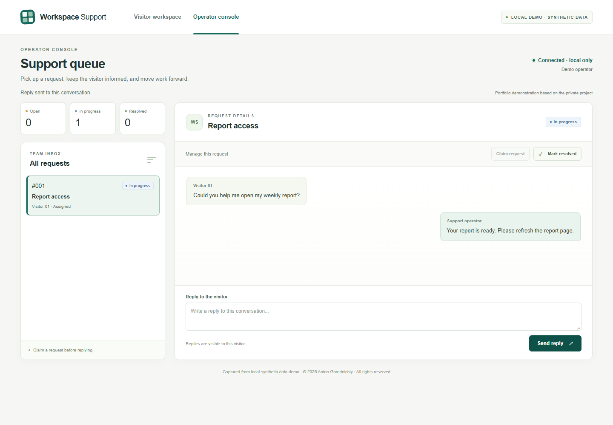

# Anton Gorodnichiy

### Python Developer — Backend & Automation

**I help turn manual requests, approvals and API work into clear Python workflows.**

Website requests into an operator queue · Task approvals with role checks · API error and duplicate handling · Small internal dashboards · Python bot and integration fixes.

[Discuss your task](mailto:anton.goro17@gmail.com) · [Послуги](SERVICES.md) · [English profile](FREELANCE_PROFILE_EN.md) · [Український профіль](FREELANCE_PROFILE_UA.md)

## See a workflow actually run

*Captured from local synthetic-data demo. The support UI is a separate portfolio demonstration based on the private project. [Watch the continuous 52-second recording](case-studies/web-operations-support-platform/assets/support-workflow.webm).*

| Client task | Evidence to inspect |
| --- | --- |
| [Website requests and operator support](case-studies/web-operations-support-platform/README.md) | Working local UI: request → queue → reply → resolved; two-visitor isolation checks |
| [Approvals and shared work](case-studies/transactional-review-workflow/README.md) | Selected original logic: competing reservations, one review result, permissions and restart |
| [API errors and repeated events](case-studies/support-workflow-orchestrator/README.md) | Selected original components: lost response, saved uncertainty and fake-state review after restart |

The first case is a new narrow demonstration. The next two exercise selected original components in private synthetic-data harnesses. Their result-viewer captures are labelled as recorded evidence. No production readiness, real customer outcome or live external integration is implied.

## What I can deliver

- Request intake and a small staff queue or support interface.
- Approval workflows with roles and task status.
- Authorized API integration with saved state and agreed failure checks.
- A focused diagnosis and fix for an existing Python bot or integration.

I define the workflow and acceptance checks, direct AI-assisted implementation, and use testing and diagnosis to refine the result. Scope, delivery terms and handover are agreed for each task.

**Core stack:** Python · FastAPI · asyncio · SQLite/PostgreSQL · SQLAlchemy · Telegram integrations · HTML/CSS/JavaScript.

[Full project index](PORTFOLIO_INDEX.md) · [Services](SERVICES.md) · [CV EN](CV_FREELANCE_EN.pdf) · [Резюме UA](CV_FREELANCE_UA.pdf)

The supporting dashboard, licensing and architecture studies remain source-reviewed. The dashboard and licensing studies are two parts of one larger project.

**Private implementation — public case study. Source code is not publicly available.**

© 2026 Anton Gorodnichiy. All rights reserved. [Rights and reuse](RIGHTS.md).
