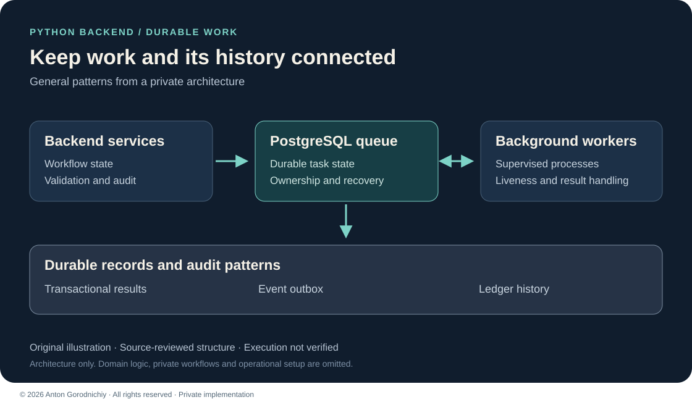

# Automation Architecture Case Study

An architecture case about durable background work, controlled retries and auditable state in a private Python platform.

**Private implementation — public case study. Source code is not publicly available.**

## Problem → Solution → Result

**Problem:** A workflow with several background workers needed to keep task ownership, results and recovery state consistent across failures.

**Solution:** A layered backend uses a PostgreSQL task queue, transactional result persistence, process supervision, an event outbox and a ledger.

**Result:** The reviewed implementation contains explicit mechanisms for work allocation, interrupted-task recovery and traceable state changes. Throughput, production reliability and deployment have not been verified in this portfolio review.

*Original architecture illustration based on source review. It shows general responsibilities, not private workflows or a running environment.*

## My role

I designed and implemented backend workflows, database task handling and recovery logic. This case focuses on the architecture I built for managing background work and preserving an audit trail.

## Stack

Python · asyncio · PostgreSQL · SQLAlchemy async · asyncpg · Alembic · FastAPI health checks

## Main features

- Persistent task allocation for background workers.
- Time-limited ownership and heartbeat-based liveness tracking.
- Transactional task completion and result persistence.
- Retry handling and recovery of expired work.
- An outbox with explicit uncertain outcomes, plus ledger corrections that retain history.

## Engineering choices

**Transactions at the workflow boundary:** Task ownership and result persistence use database transactions. This connects failure handling to durable state rather than relying only on in-memory worker status.

**Auditable outcomes:** Uncertain external outcomes have a separate state. Ledger corrections retain a traceable history. These patterns make recovery decisions easier to inspect without promising exactly-once external effects.

## What I can build for a client

- A PostgreSQL-backed queue for internal background jobs.
- An automation workflow with retries, liveness checks and recovery.
- Auditable state changes using outbox and ledger patterns.

## Status & limitations

**Verification:** reviewed in source; execution not verified.

This is an architecture case from an internal MVP. Known concurrency, retry and liveness defects remain. Controlled concurrency, recovery and load validation are required before stronger reliability claims; application tests were not executed for this review.

The public material contains no runnable automation, account data or private workflow definitions. The HTTP component shown in the stack provides health checks; a general business REST API is not claimed. See [contact](../../CONTACT.md) and [rights](../../RIGHTS.md).

© 2026 Anton Gorodnichiy. All rights reserved. [Rights and reuse](../../RIGHTS.md).
