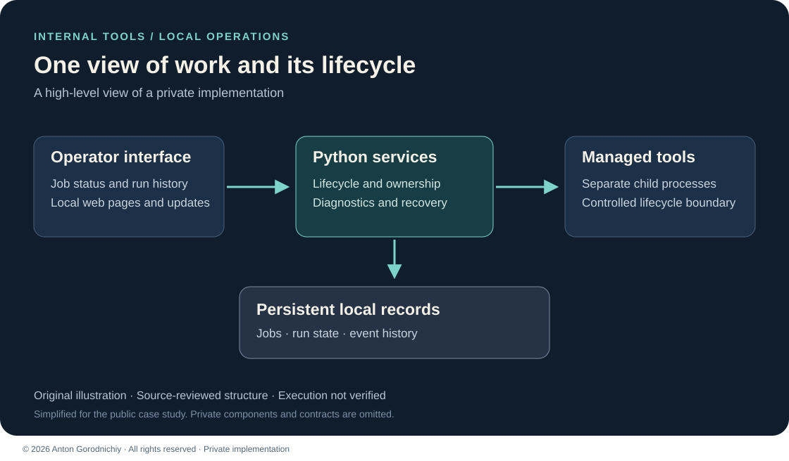

# Local Operations Dashboard

A local web interface for seeing job status, run history and process health in one place.

**Private implementation — public case study. Source code is not publicly available.**

This case focuses on the operator interface and process lifecycle of one larger private project. [Signed License Service](../signed-license-service/README.md) covers a backend component of that same project. These are two views of one project, not two independent product deliveries.

## Problem → Solution → Result

**Problem:** Several command-line tools needed a shared view of their state and a consistent way to manage their lifecycle.

**Solution:** A local dashboard connects web pages, job management, persistent run records and controlled child processes.

**Result:** The reviewed implementation brings job state, event history and restart handling into one operator workflow. Runtime behavior and productivity gains have not been measured in this portfolio review.

*Original architecture illustration based on source review; not a runtime screenshot.*

## My role

I designed and implemented the local workflow, connected the web interface to backend services, and built process-state and recovery handling. This case highlights my work on internal tools and maintainable Python integrations.

## Stack

Python · FastAPI · Jinja2 · JavaScript/CSS · WebSocket · SQLite · asyncio

## Main features

- A shared view of jobs, recent runs and operational status.
- Live status updates and an ordered event history.
- Start, stop and emergency-stop workflows for managed processes.
- Persistent run records and detection of interrupted work after restart.
- Local diagnostics and readiness information.

## Engineering choices

**Durable ownership:** Process state has a persistent record, with database constraints to limit conflicting active work. Recovery distinguishes a known record from a process the current application can safely control.

**Integration boundaries:** Existing tools remain separate from the interface. An adapter manages child processes while backend services coordinate state and reconcile completed work.

## What I can build for a client

- An internal dashboard around existing Python or command-line tools.
- A job monitor with run history, diagnostics and controlled stop actions.
- Recovery and state tracking for a local operations workflow.

## Status & limitations

**Verification:** reviewed in source; execution not verified.

This is a local operator tool with a trusted-device model. The ordinary web mode has no built-in multi-user login. Responsiveness under storage contention, unusual process output, credential storage and clean-machine installation need further validation. Application tests, installers and external integrations were not run for this case study.

Only this high-level description and original illustration are public. Implementation details remain private. See [contact](../../CONTACT.md) and [rights](../../RIGHTS.md).

© 2026 Anton Gorodnichiy. All rights reserved. [Rights and reuse](../../RIGHTS.md).
