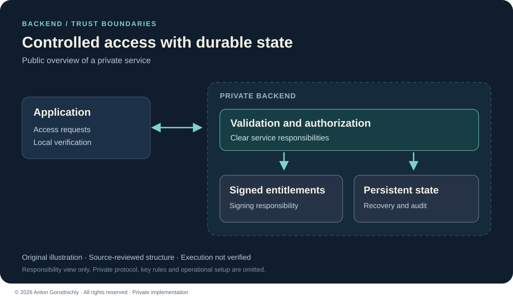

# Signed License Service

A Python backend for controlled software access, signed entitlements and recoverable license state.

**Private implementation — public case study. Source code is not publicly available.**

This backend is extracted from the same larger private project as [Local Operations Dashboard](../local-operations-dashboard/README.md). The two case studies show different engineering responsibilities within one project, not separate independent product deliveries.

## Problem → Solution → Result

**Problem:** A desktop application needed a separate service to manage access and handle interrupted license operations consistently.

**Solution:** A backend separates input validation, authorization, signing, persistent state and owner operations.

**Result:** The reviewed implementation contains a defined access lifecycle, signed entitlements and explicit recovery boundaries. Deployment and commercial use have not been verified in this portfolio review.

*Original high-level architecture illustration based on source review; not a protocol specification or runtime screenshot.*

## My role

I designed and implemented the backend, validation boundaries and persistent state handling, including recovery and operational tooling. The public case describes my engineering approach while keeping the implementation and protocol private.

## Stack

Python · FastAPI · SQLite · cryptography / Ed25519

## Main features

- Strict input validation and consistent error responses.
- Signed, time-limited software entitlements.
- Renewal handling with recovery after interrupted responses.
- Owner tools for license lifecycle changes and audit records.
- Backup, restore validation and readiness checks.

## Engineering choices

**Separate trust responsibilities:** Backend authorization, signing and client verification have distinct roles. This gives each part a clear boundary for review and testing.

**Recovery is explicit:** Durable state supports interrupted operations and controlled restoration. Recovery is part of the design rather than an assumption that every network response arrives.

## What I can build for a client

- A private licensing or entitlement backend for a desktop application.
- An API with validation, auditable state changes and recovery behavior.
- Operational tools for backup, restore and service readiness.

## Status & limitations

**Verification:** reviewed in source; execution not verified.

The related desktop beta currently leaves license enforcement disabled. Deployment, device integration, key operations and recovery were not executed in this review. Long-term record and backup retention need an operational policy. These materials make no claim of an accepted commercial release or passing application tests.

Protocol formats, key rules, implementation code and operational setup remain private. See [contact](../../CONTACT.md) and [rights](../../RIGHTS.md).

© 2026 Anton Gorodnichiy. All rights reserved. [Rights and reuse](../../RIGHTS.md).
